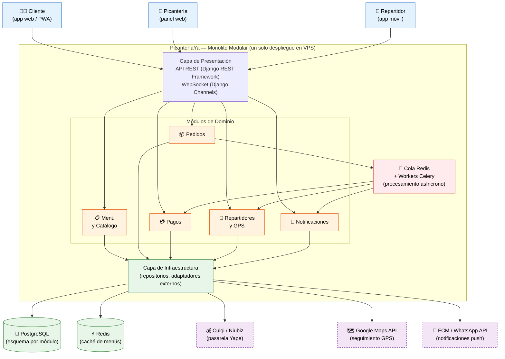
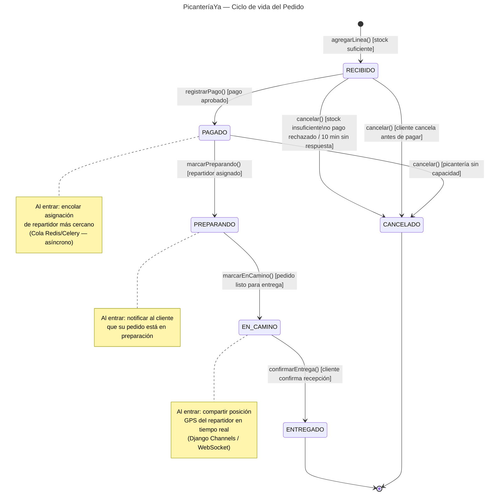
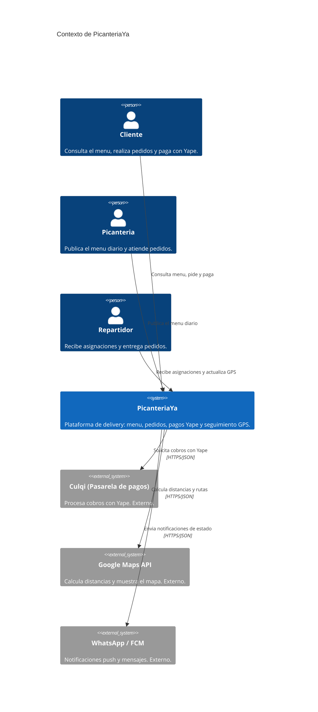

# PicanteríaYa — Laboratorio 04: Fundamentos de arquitectura de software

Construcción de Software · EPIS-UNSA · 2026-B · Grupo XX

---

## Integrantes

| Nombre | Rol en el laboratorio |
|--------|-----------------------|
| Baca Calsin Leonardo Juan Jose | Redactor de drivers y escenarios de calidad (E1), revisión de ADR |
| Chipana Jeronimo German Arturo | Diagramador (E3, E5, E6), configuración del repositorio |
| Mejia Rondan Giovanni Patrick | Redactor de ADR (E4), bitácora de IA (E7) |

---

## Caso

**PicanteríaYa** es una plataforma de delivery de picanterías arequipeñas que conecta a clientes, picanterías y repartidores. Los clientes consultan el menú del día de cada picantería, realizan pedidos y pagan con Yape; el sistema asigna automáticamente un repartidor disponible y el cliente puede seguir la ubicación del repartidor en tiempo real en el mapa.

El **atributo de calidad crítico** es la **escalabilidad**: los domingos de 12:00 a 15:00 los pedidos se multiplican por 8 respecto al flujo base (~50 pedidos/hora), alcanzando hasta **400 pedidos/hora**. La arquitectura debe absorber este pico sin rechazar pedidos ni degradar la experiencia del usuario (p95 del tiempo de confirmación ≤ 4 s, 0 pedidos rechazados por sobrecarga).

---

## Arquitectura elegida

**Estilo: Monolito Modular + Cola de mensajes Redis/Celery**  
Puntaje en matriz de decisión: **4,20 / 5,00** (ver [matriz-decision.md](docs/architecture/matriz-decision.md))



---

## Decisiones arquitectónicas

- [ADR-001: Estilo arquitectónico — Monolito modular con cola de mensajes](docs/architecture/adr/001-estilo-arquitectonico.md)
- [ADR-002: Base de datos — PostgreSQL con esquemas separados por módulo](docs/architecture/adr/002-base-de-datos.md)
- [ADR-003: Comunicación en tiempo real — WebSocket con Django Channels](docs/architecture/adr/003-comunicacion-tiempo-real.md)

---

## Estructura del repositorio

```
cs-2026b-lab04-grupoXX/
├── README.md
└── docs/
    └── architecture/
        ├── drivers.md               # E1: drivers y escenarios de calidad
        ├── matriz-decision.md       # E2: alternativas y decisión ponderada
        ├── bitacora-ia.md           # E7: 5+ interacciones con IA verificadas
        └── diagramas/
            ├── arquitectura.mmd     # E3: Mermaid — arquitectura elegida
            ├── alternativa.puml     # E5: PlantUML — alternativa descartada
            ├── despliegue.py        # E6: Python Diagrams — vista de despliegue
            └── img/                 # Imágenes exportadas (PNG/SVG)
        └── adr/
            ├── 000-plantilla.md
            ├── 001-estilo-arquitectonico.md
            ├── 002-base-de-datos.md
            └── 003-comunicacion-tiempo-real.md
```

---

## Reflexión sobre el uso de la IA

El uso de asistentes de IA en este laboratorio aceleró significativamente las primeras etapas del diseño: en minutos obtuvimos tres alternativas arquitectónicas con sus pros y contras, y borradores de ADR bien estructurados. Sin embargo, la IA demostró limitaciones importantes que obligaron al equipo a ejercer juicio crítico.

El error más revelador fue que Claude asumió que **Yape dispone de una API pública abierta** para integración directa, lo cual es incorrecto: verificamos en la documentación oficial de Yape y en foros de desarrollo peruano que la integración requiere un proveedor intermediario con acuerdo comercial. Este error habría impactado directamente el MVP si lo hubiéramos aceptado sin verificar.

También notamos que la IA tiende a **proponer arquitecturas sobredimensionadas**: recomendó Kubernetes y microservicios para 400 pedidos/hora, cuando calculamos que equivale a 6–7 pedidos/minuto, perfectamente manejables con un monolito y una cola asíncrona. La IA no ponderó nuestras restricciones de equipo (3 developers sin DevOps) ni de presupuesto (VPS único de $20/mes).

El aprendizaje central: **la IA es un excelente generador de borradores y listas de opciones**, pero no conoce el contexto real del proyecto ni las restricciones del equipo. Cada propuesta debe verificarse contra la documentación oficial y los drivers del sistema.

---

## Diseño UML (Lab 05)

> **Laboratorio 05:** UML como código — Diagramas de diseño detallado del módulo Pedidos
>
> Historia crítica modelada: **HU-01 — Pedir el menú del día y pagar con Yape**

### Diagrama de estados del Pedido (E3)



### Índice de diagramas y documentos de diseño

| Entregable | Archivo | Descripción |
|------------|---------|-------------|
| E1 | [historia.md](docs/design/historia.md) | Historia HU-01 con 3 criterios de aceptación |
| E1 | [clases.puml](docs/design/clases.puml) | Diagrama de clases — módulo Pedidos (PlantUML) |
| E2 | [secuencia-pedir-pagar.puml](docs/design/secuencia-pedir-pagar.puml) | Secuencia: pedir menú + pagar con Yape (PlantUML) |
| E3 | [estados-pedido.mmd](docs/design/estados-pedido.mmd) | Máquina de estados del Pedido (Mermaid) |
| E4 | [actividades-asignacion-repartidor.puml](docs/design/actividades-asignacion-repartidor.puml) | Actividades: asignación del repartidor más cercano (PlantUML) |
| E5 | [paquetes.puml](docs/design/paquetes.puml) | Diagrama de paquetes del monolito modular (PlantUML) |
| E6 | [src/pedidos/dominio.py](src/pedidos/dominio.py) | Esqueleto de código Python generado desde el diagrama de clases |
| E6 | [round-trip.md](docs/design/round-trip.md) | Tabla de diferencias: diagrama ↔ código (ingeniería inversa) |
| E7 | [consistencia.md](docs/design/consistencia.md) | Hallazgos C1–C5 con falso positivo identificado |
| E7 | [bitacora-ia.md](docs/design/bitacora-ia.md) | Bitácora: 5 interacciones con IA verificadas |

### Estructura del repositorio (Lab 05)

```
cs-2026b-lab04-grupoXX/
├── README.md                              ← E8: sección Diseño UML agregada
├── docs/
│   ├── architecture/                      ← Lab 04 (sin cambios)
│   └── design/                            ← Lab 05 (nuevo)
│       ├── historia.md                    ← E1
│       ├── clases.puml                    ← E1
│       ├── secuencia-pedir-pagar.puml     ← E2
│       ├── estados-pedido.mmd             ← E3
│       ├── actividades-asignacion-repartidor.puml ← E4
│       ├── paquetes.puml                  ← E5
│       ├── round-trip.md                  ← E6
│       ├── consistencia.md                ← E7
│       ├── bitacora-ia.md                 ← E7
│       └── img/                           ← PNG/SVG de todos los diagramas
└── src/
    └── pedidos/
        └── dominio.py                     ← E6: esqueleto Python
```

---

## Arquitectura C4 (Lab 06)

> Modelo generado desde `docs/architecture/c4/workspace.dsl` con Structurizr DSL. Todas las vistas son coherentes con el ADR-001 (Monolito Modular) y los diagramas UML del Laboratorio 05.

### Nivel 1 — Diagrama de contexto



### Vistas del modelo C4

| Vista | Archivo fuente | Descripción |
|-------|----------------|-------------|
| **Nivel 1: Contexto** | [workspace.dsl](docs/architecture/c4/workspace.dsl) · [img](docs/architecture/c4/img/) | Sistema, personas y sistemas externos |
| **Nivel 2: Contenedores** | [workspace.dsl](docs/architecture/c4/workspace.dsl) · [img](docs/architecture/c4/img/) | PWA, App Repartidor, API, Worker, BD, Redis, WebSocket |
| **Nivel 3: Componentes** | [workspace.dsl](docs/architecture/c4/workspace.dsl) · [img](docs/architecture/c4/img/) | Menú, Pedidos, Pagos, Repartidores, Notificaciones |
| **Dinámica: Pedir y pagar** | [workspace.dsl](docs/architecture/c4/workspace.dsl) · [img](docs/architecture/c4/img/) | Flujo del caso de uso crítico (8 pasos) |
| **Despliegue: Producción** | [workspace.dsl](docs/architecture/c4/workspace.dsl) · [img](docs/architecture/c4/img/) | VPS Ubuntu, Docker Compose, dispositivos |
| **Contexto manual (C4-PlantUML)** | [contexto-manual.puml](docs/architecture/c4/contexto-manual.puml) | Versión escrita a mano para comparación (E6) |

### Documentos del Lab 06

| Entregable | Archivo | Contenido |
|------------|---------|-----------|
| E1 | [inventario.md](docs/architecture/c4/inventario.md) | Tabla de todos los elementos con tipo C4 y origen |
| E6 | [comparacion.md](docs/architecture/c4/comparacion.md) | Structurizr DSL vs. C4-PlantUML manual |
| E7 | [revision-c4.md](docs/architecture/c4/revision-c4.md) | Lista de revisión oficial + hallazgos IA |
| E7 | [explicacion.md](docs/architecture/c4/explicacion.md) | Explicación para público no técnico (≤120 palabras) |
| E7 | [bitacora-ia.md](docs/architecture/c4/bitacora-ia.md) | 5 interacciones con la IA documentadas |

**Tag de entrega:** `v0.6-c4`

---

## Recursos y herramientas

- Editor Mermaid en línea: https://mermaid.live
- Editor PlantUML en línea: https://www.plantuml.com/plantuml
- Structurizr DSL: https://docs.structurizr.com/dsl
- C4 model: https://c4model.com
- Python Diagrams: https://diagrams.mingrammer.com/
- Guía Lab 04: `Guia_Lab04_Fundamentos_Arquitectura_Software_2026B.pdf`
- Guía Lab 05: `Guia_Lab05_Diagramas_Diseno_UML_2026B.pdf`
- Guía Lab 06: `Guia_Lab06_Modelo_C4_2026B.pdf`
- Guía Lab 07: `Guia_Lab07_Patrones_Diseno_2026B.pdf`
- refactoring.guru: https://refactoring.guru/es/design-patterns

---

## Patrones de diseño — Lab 07

> Tag de entrega: **`v0.7-patrones`** · Plazo: 24/10/2026 · ADR: [005-patrones-de-diseno.md](docs/architecture/adr/005-patrones-de-diseno.md)
>
> [](../../actions/workflows/patrones-ci.yml)

### Flujo refactorizado: `confirmar_y_pagar()` — módulo Pedidos

Se refactorizó el flujo crítico modelado en el Lab 05 aplicando **7 patrones GoF**. La complejidad ciclomática máxima bajó de **14 (C)** a **4 (A)**.

### Tabla: olor → patrón → prueba

| Olor detectado | Patrón(es) | Archivo | Prueba que lo demuestra |
|----------------|-----------|---------|------------------------|
| `if/elif` por medio de pago que crece con cada nuevo método | **Strategy + Factory** | `pagos.py` | `test_open_closed_nuevo_medio_sin_modificar_el_servicio` |
| El servicio conoce detalles de cada SDK (dict, céntimos, tupla) | **Adapter** | `pagos.py` | `test_yape_adapter_traduce_dict_a_resultado_pago` |
| Bloque de reintentos duplicado para Yape y Culqi | **Decorator** (`ConReintentos`) | `pagos.py` | `test_con_reintentos_reintenta_ante_timeout` |
| Condicionales anidados sobre `pedido.estado` | **State** | `estados.py` | `test_state_impide_transicion_invalida_entregado_cancelar` |
| Notificaciones WhatsApp "a mano" en el servicio | **Observer** | `eventos.py` | `test_observer_nuevo_suscriptor_sin_tocar_el_servicio` |
| Lógica transversal (GPS) mezclada en suscriptores | **Decorator** (`ConSeguimientoGPS`) | `eventos.py` | `test_con_seguimiento_gps_agrega_log_sin_modificar_suscriptor` |
| IA acoplada: if/elif por proveedor + validaciones mezcladas | **Strategy + Adapter + Decorator + Chain of Responsibility** | `ia.py` | `test_sugerir_descripcion_bloquea_respuesta_con_precio` |

### Tabla de métricas (radon)

| Métrica | Antes | Después | Cambio |
|---------|-------|---------|--------|
| Complejidad máxima | 14 (C) | 4 (A) | −71 % |
| Complejidad promedio | 5.5 (B) | 1.65 (A) | −70 % |
| SLOC | 112 | 328 | +193 % |
| Pruebas | 0 | **50** | +50 |

### Error de la IA detectado por las pruebas

La primera versión de `ConReintentos` generada por IA capturaba `Exception` en lugar de `TimeoutError`, causando reintentos en pagos rechazados (riesgo de cobro duplicado). La prueba `test_con_reintentos_no_reintenta_pago_rechazado` falló y se corrigió manualmente.

### Estructura del módulo refactorizado

```
src/pedidos/
├── antes/servicio.py          # E1: versión ingenua (se conserva)
├── externos.py                # E1: SDKs simulados con interfaces distintas
├── pagos.py                   # E2: Strategy + Adapter + Factory + Decorator
├── estados.py                 # E3: State (implementa estados-pedido.mmd Lab05)
├── eventos.py                 # E4: Observer + Decorator GPS
├── ia.py                      # E5: Strategy + Adapter + Decorator caché + Chain
└── servicio.py                # Servicio refactorizado (complejidad 2)
tests/
├── test_comportamiento.py     # E1: 12 pruebas de caracterización
└── test_patrones.py           # E2–E5: 38 pruebas de patrones
docs/design/patrones/
├── olores.md                  # E1: tabla de olores con decisiones
├── metricas.md                # E6: radon antes/después + trade-off
├── pagos-strategy-adapter-factory.puml   # E7
├── estados-state.puml                    # E7
├── eventos-observer-decorator.puml       # E7
├── ia-strategy-decorator-chain.puml      # E7
├── img/                                  # E7: PNGs generados
└── bitacora-ia.md                        # E7: 5 interacciones con IA
docs/architecture/adr/
└── 005-patrones-de-diseno.md  # E8: ADR con patrones adoptados y rechazados
```

---

## Diseño de la arquitectura (Lab 08)

[](https://github.com/ChipanaGerman/cs-2026b-lab04-grupoXX/actions/workflows/fitness.yml)

**Escenario de crecimiento:** "Día de la Picantería" — 10× más pedidos en 3 horas + seguimiento GPS cada 5 s.

### Árbol de utilidad

9 escenarios cubriendo 4 atributos · ver [arbol.dot](docs/architecture/utilidad/arbol.dot) + [arbol.png](docs/architecture/utilidad/arbol.png)

| ID | Atributo | Escenario | Calificación | Guía iteración ADD |
|----|----------|-----------|-------------|-------------------|
| QA-01 | Rendimiento | 400 clientes consultan menú → p95 ≤ 1 s | **(H,H)** | Iteración 1 |
| QA-02 | Rendimiento | 10× pedidos en 3 h → p95 confirmación ≤ 4 s | **(H,H)** | Iteración 1 |
| QA-03 | Rendimiento | GPS cada 5 s → WebSocket ≤ 500 ms | **(H,M)** | — |
| QA-04 | Disponibilidad | Pasarela caída 20 min → 0 pedidos perdidos | **(H,H)** | Iteración 2 |
| QA-05 | Disponibilidad | Falla servidor → recuperación ≤ 30 s | **(H,M)** | — |
| QA-06 | Seguridad | Datos personales expuestos → 0 filas | **(M,L)** ⚠️ IA propuso (H,H) | — |
| QA-07 | Seguridad | Repartidor A ve pedidos de Picantería B → 0 filas ajenas | **(H,M)** | Iteración 3 |
| QA-08 | Modificabilidad | Nuevo distrito → ≤ 1 día-persona, 0 módulos tocados | **(H,L)** | Iteración 3 |
| QA-09 | Modificabilidad | Nueva pasarela de pago → ≤ 2 h-persona | **(M,L)** | — |

### Iteraciones ADD y evidencia

| Iteración | Escenario objetivo | Táctica adoptada | Rechazada | Evidencia | p95 antes | p95 después | ¿Cumple? |
|-----------|-------------------|-----------------|-----------|-----------|-----------|-------------|---------|
| [1](docs/architecture/add/iteracion-1.md) | QA-01 + QA-02 | Índice `plato(picanteria_id, activo)` + caché Redis TTL=30 s | Microservicios + K8s (IA) | Simulación M/G/c | 97 ms | **26 ms** (QA-01) / **219 ms** (QA-02) | ✅ |
| [2](docs/architecture/add/iteracion-2.md) | QA-04 | Circuit Breaker + outbox PostgreSQL | Cola en Redis (IA) | Monte Carlo | 31 perdidos | **9 llamadas en caída** | ✅ |
| [3](docs/architecture/add/iteracion-3.md) | QA-07 + QA-08 | RLS PostgreSQL + `picanteria_id` | BD por picantería (IA) | Análisis comparativo | — | RLS verificado en CI | ✅ |

### ADRs producidos

| ADR | Decisión | Evidencia |
|-----|---------|-----------|
| [ADR-006](docs/architecture/adr/006-tacticas-rendimiento.md) | Índice + caché Redis TTL=30 s | Simulación M/G/c: p95 = 26 ms a 400 req/h |
| [ADR-007](docs/architecture/adr/007-disponibilidad-pago.md) | CB + outbox PostgreSQL | Monte Carlo: 9 llamadas al proveedor caído vs 93 |
| [ADR-008](docs/architecture/adr/008-seguridad-modificabilidad.md) | RLS + `picanteria_id` + tabla `distrito_reparto` | Análisis comparativo + fitness function FF-06 |

### Fitness functions (E5)

| ID | Tipo | Qué verifica | Herramienta | ¿Pasa? |
|----|------|-------------|-------------|-------|
| FF-01a/b | Estructural | `estados` y `eventos` no importan `externos` directamente | import-linter | ✅ |
| FF-02/02b | Estructural | `estados` no depende de `pagos`; `eventos` no depende de `estados` | import-linter | ✅ |
| FF-03 | Calidad (rendimiento) | p95 menú ≤ 1 000 ms en pico 400 req/h | pytest + simulación | ✅ 26 ms |
| FF-04 | Calidad (rendimiento) | p95 confirmación ≤ 4 000 ms en Día Picantería (10×) | pytest + simulación | ✅ 219 ms |
| FF-05 | Calidad (disponibilidad) | CB reduce llamadas al proveedor caído vs solo reintentos | pytest + Monte Carlo | ✅ 9 vs 93 |
| FF-06 | Aislamiento | ADR-008 menciona RLS; iteración 3 documenta `picanteria_id` | pytest (AST + archivos) | ✅ |

> **Degradación que detecta cada FF:**
> - FF-01/02: alguien agrega un `import` directo que viola la separación de capas → CI falla.
> - FF-03/04: alguien elimina el índice o la caché → p95 sube por encima del presupuesto → CI falla.
> - FF-05: alguien desactiva el Circuit Breaker → más llamadas al proveedor caído → CI falla.
> - FF-06: ADR-008 o iteración-3 no documentan RLS/`picanteria_id` → CI falla.


