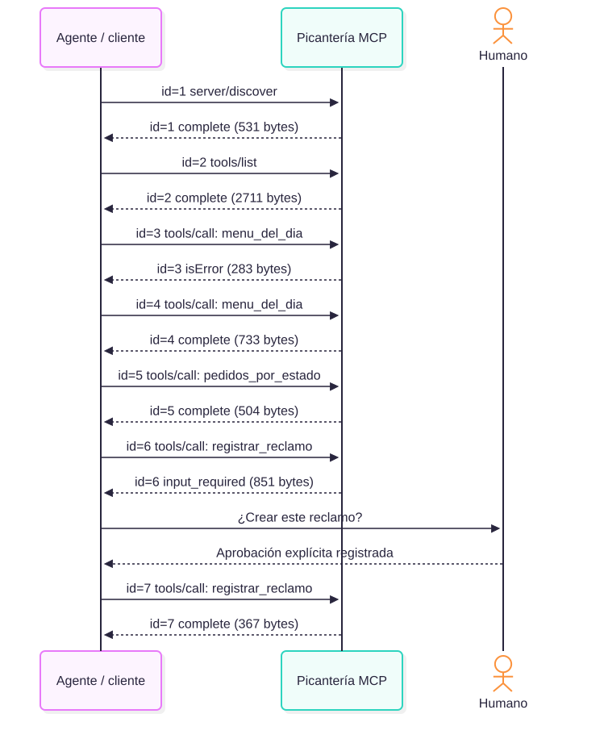

# Picantería Ya: Servidor MCP (Lab 11)

Python 3.13 recomendado. Datos ficticios del 24/11/2026. SDK oficial MCP 2.3.0, protocolo 2026-07-28 y stdio.

## Instalación y ejecución

Desde la raíz del repositorio, en PowerShell:

```powershell
python -m venv .venv-mcp
./.venv-mcp/Scripts/python.exe -m pip install -r agentes/mcp/requirements-lock.txt
./.venv-mcp/Scripts/python.exe -X utf8 -B -m agentes.mcp.cliente.explorar
./.venv-mcp/Scripts/python.exe -X utf8 -B -m pytest -q -p no:cacheprovider agentes/mcp/pruebas
./.venv-mcp/Scripts/python.exe -X utf8 -B -m agentes.mcp.agente.ejecutar
```

En Linux/macOS sustituir `.venv-mcp/Scripts/python.exe` por `.venv-mcp/bin/python`. Las pruebas no requieren LLM, claves ni red después de instalar dependencias. Las aceptaciones de pytest son fixtures; una ejecución interactiva solicita permiso al usuario antes de crear.

## Catálogo

| Primitiva | Nombre | Alcance |
|---|---|---|
| tool | menu_del_dia | Platos disponibles, stock y precios; fecha 2026-11-24, La Tradición |
| tool | pedidos_por_estado | Máximo 20, estado del dominio, UUID y total; sin datos personales |
| tool | registrar_reclamo | Única escritura: crea con consentimiento mediante MRTR, sin sobrescribir |
| resource | picanteria://zonas | Cobertura de delivery ficticia |
| resource | picanteria://reglas | Reglas y límites |
| resource template | picanteria://adr/{numero} | ADR por tres dígitos |
| prompt | responder_reclamo | Atención basada en hechos, sin inventar reembolsos |

## Host real

La configuración Windows está en ../../.vscode/mcp.json. Abrir la raíz con un VS Code que soporte MCP, Copilot en modo Agent, iniciar el servidor picanteria-ya y revisar las herramientas antes de usarlas. Mantener activas las confirmaciones de escritura. La versión del host debe soportar el protocolo y MRTR; un host antiguo no basta aunque tenga Copilot instalado. Consultas, observaciones y limitaciones: [uso-en-host.md](uso-en-host.md).

## Evidencias y reproducción

- [Catálogo y justificación E1](diseno/catalogo-mcp.md).
- [Contratos e Inspector E3](pruebas/inspector.md).
- [Integración interactiva E4](agente/README.md).
- [Tráfico, métricas y optimización E6](protocolo.md).
- [Auditoría E7](seguridad.md) y [bitácora](bitacora-ia.md).
- [ADR-011](../../docs/architecture/adr/011-servidor-mcp.md).
- [Reto B](reto/README.md), [cuestionario](cuestionario.md), [checkpoint](checkpoint.md) y [matriz de entrega](entrega.md).



No conectar terceros/clima_mcp.py a un host con LLM: es una fixture de poisoning para el auditor. No representa el archivo de recursos original, que no fue proporcionado.
