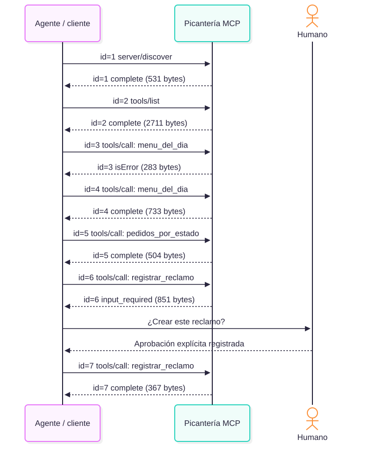

# E6: tráfico y costo de contexto

Fuente: trazas/negocio.jsonl, generada durante E4 mediante el espía stdio. Cada línea registra el mensaje JSON-RPC, dirección, bytes efectivamente transmitidos (UTF-8 y salto de línea) y latencia medida desde enviar hasta recibir. Las pausas de decisión y aprobación humana no se incluyen en la latencia de método.

## Resultados medidos

14 mensajes, 8.327 bytes, un error de negocio corregido. No hubo initialize ni sesión: cada petición lleva versión 2026-07-28 y capacidades en `_meta`. server/discover anuncia versiones y capacidades. La llamada de escritura tiene dos rondas: input_required y complete.

| Método | Peticiones | Media ms | Mínimo ms | Máximo ms |
|---|---:|---:|---:|---:|
| server/discover | 1 | 2666,324 | 2666,324 | 2666,324 |
| tools/list | 1 | 5,984 | 5,984 | 5,984 |
| tools/call | 5 | 44,590 | 5,225 | 182,631 |

El descubrimiento incluye el arranque de Python y las importaciones. Es una ejecución local pequeña, no un benchmark de capacidad ni un percentil. La guía tiene otros números porque su servidor y equipo son distintos.

Fuente editable: [negocio.mmd](trazas/negocio.mmd). Regenerar con `.venv-mcp/Scripts/python -B -m agentes.mcp.cliente.traza_mcp` y `npx @mermaid-js/mermaid-cli -i agentes/mcp/trazas/negocio.mmd -o agentes/mcp/trazas/negocio.svg -b white`.

## Optimización reproducible

Se capturó tools/list antes y después en procesos nuevos. Se compactaron las tres descripciones, conservando nombres, parámetros, formatos, estados permitidos y exigencia de permiso humano. No se quitó outputSchema ni validación para aparentar un ahorro mayor.

| Métrica del catálogo completo de herramientas | Antes | Después | Reducción |
|---|---:|---:|---:|
| Caracteres JSON compacto | 2513 | 2473 | 40 (1,59 %) |
| Bytes UTF-8 | 2518 | 2476 | 42 (1,67 %) |
| Tokens estimados | 629 | 619 | 10 (1,59 %) |

Método: ceil(caracteres/4), igual para ambas mediciones; **no son tokens exactos del tokenizer de Copilot**. Incluye esquemas de entrada, salida y anotaciones; no incluye instrucciones del host, historial ni respuestas. Si el host solo transmite una parte del catálogo o lo cachea, su costo efectivo puede ser distinto.

Los JSON completos y su método están en trazas/catalogo-{antes,despues}.json y trazas/costo-{antes,despues}.json. Repetir con `python -m agentes.mcp.cliente.medir_catalogo antes` antes de modificar descripciones y con `despues` al finalizar.

La revisión del asistente mantuvo la selección: consultar menú → menu_del_dia; localizar cancelados → pedidos_por_estado; crear reclamo → registrar_reclamo. Después de optimizar, Copilot también eligió esas tres herramientas en E5: las consultas devolvieron los datos correctos y la escritura llegó al permiso del host. Las transcripciones están en trayectorias/host. Los contratos automatizados vuelven a ejecutar ambas consultas y la confirmación completa después del cambio. La creación en el host sigue pendiente de aprobación; no se deduce su éxito solo del ahorro de tokens.
