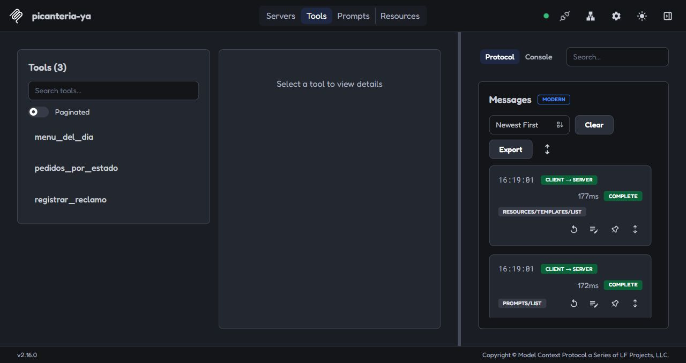
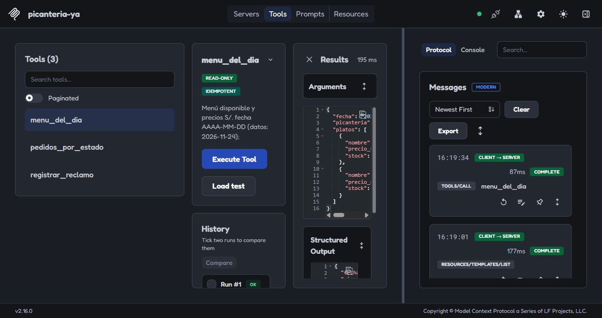
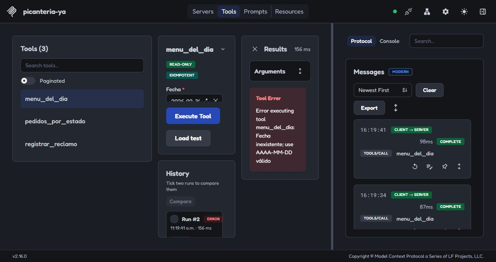

# E3: contratos e Inspector

24/11/2026: 17 casos de contrato y 7 casos MRTR, todos en verde con Python 3.13.3, MCP 2.3.0 y pytest 9.2.0. Ejecución sin LLM ni red: `.venv-mcp/Scripts/python -X utf8 -B -m pytest -q -p no:cacheprovider agentes/mcp/pruebas`.

Se verifican descubrimiento sin initialize, catálogo estable, una única escritura, anotaciones, outputSchema validado con jsonschema, errores corregibles, estados, privacidad, dos recursos, plantilla ADR, traversal simple y codificado, prompt y error JSON-RPC. Los casos del reto comprueban confirmación previa, aceptación, rechazo, cancelación, false, replay, alteración y token inventado.

## Inspector oficial 2.16.0

La versión npm sin sufijo resolvió a Inspector 1.0.6 obsoleto. Se fijó `@modelcontextprotocol/inspector@2.16.0` con Node 24 temporal porque Node 22.15 instalado no cumple su requisito de motor.

```powershell
npx.cmd -y -p node@24 -p @modelcontextprotocol/inspector@2.16.0 mcp-inspector --web --protocol-era modern ./.venv-mcp/Scripts/python.exe -X utf8 -B agentes/mcp/servidor_mcp/picanteria_mcp.py
```

Abrir la URL local que imprime Inspector; su token temporal no se guarda en la configuración ni se necesita en el repositorio. Activar la conexión stdio y entrar en Tools.

### 1. Catálogo real



Se observan menu_del_dia, pedidos_por_estado y registrar_reclamo. La conexión informa MCP 2026-07-28. Las consultas están anotadas read-only; registrar_reclamo es la única escritura.

### 2. Llamada correcta



menu_del_dia con 2026-11-24 y La Tradición: Run #1 OK, salida JSON y Structured Output. Resultado esperado y obtenido: rocoto relleno S/25.00, stock 12; chupe S/35.50, stock 8. No aparece adobo agotado. Inspector midió 195 ms de extremo a extremo de su interfaz; no equivale a la latencia stdio de E6.

### 3. Error útil



2026-02-30 produce Run #2 ERROR y «Fecha inexistente; use AAAA-MM-DD válido». No es un fallo del transporte: el resultado de herramienta contiene isError=true. El estado accesible observado se conserva en capturas/inspector-estado.txt.
