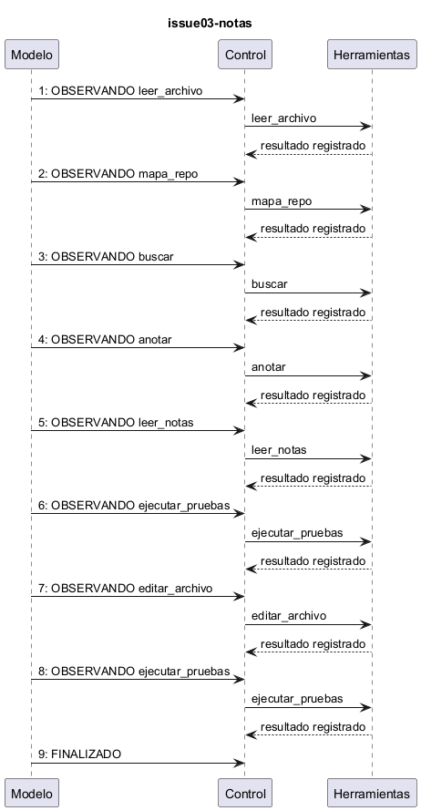

# E7. Observación de ejecuciones reales

| Ejecución | Pasos | Rondas | Acciones | Contratos rechazados | Bloqueadas | Contexto final (car.) |
|---|---:|---:|---:|---:|---:|---:|
| issue01-interactivo | 7 | 1 | 6 | 0 | 0 | 16785 |
| issue02-actor-r1 | 3 | 1 | 2 | 0 | 0 | 12742 |
| issue02-actor-r2 | 3 | 2 | 2 | 0 | 0 | 2913 |
| issue02-critico-r1 | 4 | 1 | 3 | 0 | 1 | 4095 |
| issue02-critico-r2 | 3 | 2 | 2 | 0 | 0 | 3173 |
| issue02-planificador | 2 | 1 | 1 | 0 | 0 | 2354 |
| issue02-unico | 8 | 1 | 7 | 0 | 0 | 19511 |
| issue03-notas | 9 | 1 | 8 | 0 | 0 | 14135 |

Pasos cuenta decisiones solicitadas, incluida la final. Acciones cuenta llamadas permitidas o bloqueadas; los rechazos de contrato se cuentan por separado. Rondas indica el número de ronda de esa traza; no debe sumarse entre actores de una misma ronda. Contexto es la longitud JSON del historial final, incluido catálogo y observaciones, sin convertir caracteres en tokens ni estimar dinero.

| Ejecución | Herramientas intentadas |
|---|---|
| issue01-interactivo | editar_archivo, ejecutar_pruebas, leer_archivo |
| issue02-actor-r1 | editar_archivo, leer_archivo |
| issue02-actor-r2 | editar_archivo, ejecutar_pruebas |
| issue02-critico-r1 | editar_archivo, ejecutar_pruebas, ver_cambios |
| issue02-critico-r2 | ejecutar_pruebas, ver_cambios |
| issue02-planificador | leer_archivo |
| issue02-unico | editar_archivo, ejecutar_pruebas, leer_archivo |
| issue03-notas | anotar, buscar, editar_archivo, ejecutar_pruebas, leer_archivo, leer_notas, mapa_repo |

## E5. Comparación agregada

Agente único: 7 acciones, 19511 caracteres finales, una ronda. Gestor + actor-crítico: 10 acciones, 25277 caracteres finales acumulados entre contextos y dos rondas. Bloqueos: 1. Sumar contextos finales mide volumen acumulado de sesiones, no tokens facturados ni todas las llamadas.

El crítico detectó que `isinstance(True, int)` acepta una cantidad booleana.  
El agente único también encontró el fallo con las mismas pruebas y llegó al mismo parche.  
El esquema actor-crítico necesitó dos rondas y un contexto separado para cada rol.  
La separación bloqueó un intento de escritura del revisor.  
No apareció un defecto exclusivo del crítico que las pruebas del agente único omitieran.  
Para estos issues pequeños conviene el agente único con tests y revisión humana.  
Se reservaría actor-crítico para cambios de mayor riesgo: esa decisión respeta parsimonia (sección 1.7).

## E4. Efecto observado

E2: 7 pasos y 16785 caracteres. E4: 9 pasos y 14135 caracteres. Las notas agregan llamadas; el mapa evita leer todo el dominio. Issues distintos y catálogos distintos impiden atribuir causalmente el cambio de contexto a una sola herramienta.

## Trayectoria del issue 3

## Procedencia y límites

E2 usa ModeloInteractivo con respuestas de Codex introducidas por consola. E4/E5 usan decisiones preparadas y replay, no inferencias autónomas nuevas. Las herramientas y pruebas se ejecutaron realmente. Los intentos inválidos del revisor son casos adversarios deliberados, no un fallo espontáneo de un proveedor. No hubo credenciales ni datos reales. Las aprobaciones automatizadas no acreditan una intervención humana. Ver delegacion.md.
